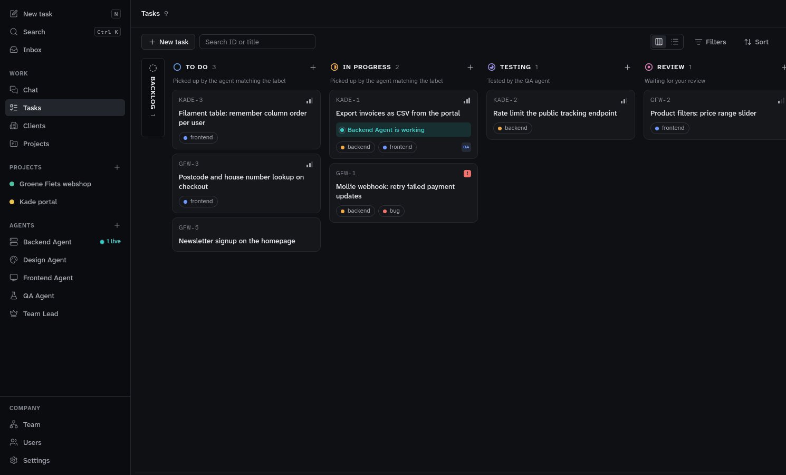

<p align="center">
  <picture>
    <source media="(prefers-color-scheme: dark)" srcset="design/brand/logo-horizontal-on-dark.svg">
    <source media="(prefers-color-scheme: light)" srcset="design/brand/logo-horizontal-on-light.svg">
    
  </picture>
</p>

<div align="center">

**A desktop app where a team of AI agents works through your board.**

[Install](#install) · [Docs](#documentation) · [Releases](https://github.com/Yotech-AI/gizai/releases) · [Licence](LICENSE)



</div>

## What it is

GizAi is an Agentic Development Application (ADA): a team of AI agents builds your software through your board, while you review and decide. Each card gets its own git worktree, an agent builds it, a QA agent tests it, and it lands in your Review. Everything runs on your own computer, with your own git repositories, logins and coding CLIs.

## Features

- **The board decides who works.** Each column holds the agents that work its cards, so cards move from builder to tester to you by themselves. [Read more](docs/features/board.md)
- **A Team Lead you talk to.** Ask the Team Lead in chat to plan work, make cards or start agents, and Approve with one click (or Approve all) the steps that wait for your OK. [Read more](docs/features/team-lead.md)
- **Bring your own CLI.** Each agent runs on the coding CLI you pick, like Claude Code, Codex or Gemini, on your own machine with your own logins and accounts. [Read more](docs/features/cli.md)
- **Tested before you see it.** A QA agent tests a card before it reaches your Review, and opens its pull request on GitHub. [Read more](docs/features/testing.md)
- **The Editor and Terminal, built in.** Open a project or a card's worktree, see its git status and edit it, with your own shell in a panel under the code or on its own page. [Read more](docs/features/editor-and-terminal.md)
- **Memory.** The Team Lead, the agents and you keep notes for later, and each run gets the notes for its card. [Read more](docs/features/memory.md)
- **Tools per agent.** Give each agent only the commands, folders, MCP servers, web access and hidden browser it needs. [Read more](docs/features/tools.md)
- **The Inbox.** Questions, approvals, commands to run and cards to review wait for you in one list. [Read more](docs/features/inbox.md)

## Install

GizAi builds from source and installs for you alone, without sudo or administrator rights. Every system needs git, Rust, Node.js 20 or newer, and Claude Code or Codex, logged in.

- **Linux:** also WebKitGTK 4.1, and for the tray icon `libayatana-appindicator` on Arch and Omarchy or `libayatana-appindicator3-1` on Debian and Ubuntu. `./install.sh --check` names the packages.
- **macOS** on Apple silicon: also Apple's Command Line Tools, from `xcode-select --install`.

```sh
git clone --branch production https://github.com/Yotech-AI/gizai.git
cd gizai
./install.sh
```

- **Windows 11:** also the Microsoft C++ Build Tools and Git for Windows. Run this in PowerShell:

```powershell
git clone --branch production https://github.com/Yotech-AI/gizai.git
cd gizai
powershell -NoProfile -ExecutionPolicy Bypass -File .\install.ps1
```

The details are in [docs/install.md](docs/install.md): what each system needs, updates, your data, and what to do when macOS or Windows warns.

## Getting started

1. Install Claude Code or Codex and log in to it. The Team Lead's chat needs Claude Code.
2. For projects on GitHub, install gh and log in (`gh auth login`, or Settings → GitHub): QA opens the pull requests with it.
3. Open GizAi: the workflow and five agents are ready. Talk to the Team Lead on the Chat page.
4. Add a project with its git repository, and put a card in To do.
5. The Backend or Frontend Agent builds it, the QA Agent tests it, and it lands in your Review.

## Documentation

- [Install](docs/install.md): what each system needs, when macOS or Windows warns, updates, your data and no telemetry.
- [Settings](docs/settings.md): what each tab holds, how GizAi looks, and the tray.
- Features: [Board](docs/features/board.md) · [Team Lead](docs/features/team-lead.md) · [CLIs](docs/features/cli.md) · [Testing](docs/features/testing.md) · [Editor and Terminal](docs/features/editor-and-terminal.md) · [Memory](docs/features/memory.md) · [Tools](docs/features/tools.md) · [Inbox](docs/features/inbox.md)
- [Memory in depth](docs/memory.md): folders, properties, links, search, and how runs get notes.
- [Agent tools in depth](docs/agent-tools.md): MCP servers, signing in, the web, the browser and the safety rules.
- [Linux, macOS and Windows](docs/PLATFORMS.md): what differs on each system.
- [Releasing](docs/RELEASING.md): how a release is made, and how GizAi updates itself.
- [Paid features](docs/PAID-FEATURES.md): the plan for paid hosted services; the app stays free.

## Development

```sh
source scripts/env.sh
cargo test --workspace && npm test
scripts/ui-test.sh        # UI tests in a headless compositor, never on your desktop
scripts/readme-gif.sh     # remakes the GIF above
scripts/tour-capture.sh   # the product tour's stills, in dark and light, into video/capture/
```

On every pull request and every push to `main`, CI (`.github/workflows/ci.yml`) builds Gizai and runs `cargo test --workspace` and `npm test` on Linux, macOS (Apple silicon) and Windows, and checks the install scripts there. A pull request that changes an install script also installs Gizai from source on macOS and Windows with it (`.github/workflows/install.yml`). A pull request into `main` that changes nothing but Gizai's version, a release's first step, skips both, and its checks pass within a minute or two: the release's pull request into `production` runs them in full (`docs/RELEASING.md`).

[CLAUDE.md](CLAUDE.md) has the rules for working in this repository, [docs/HANDOFF-2026-10-07.md](docs/HANDOFF-2026-10-07.md) explains how it is built, and [docs/RELEASING.md](docs/RELEASING.md) how a release is made.

## Licence

GizAi is open source under the [Apache License 2.0](LICENSE); see also [NOTICE](NOTICE). You may use, change and share it, also commercially, if you include the licence and the NOTICE and mark the files you changed. The licence gives no rights to the GizAi name and logo. Releases published before the switch to Apache-2.0 stay under the MIT licence.

The whole app is free, with the agents, the Team Lead's chat, the Editor and the terminals; the plan for paid features is hosted services only, like an encrypted backup and sync ([docs/PAID-FEATURES.md](docs/PAID-FEATURES.md)).

GizAi is not affiliated with Anthropic. Claude and Claude Code are trademarks of Anthropic.
